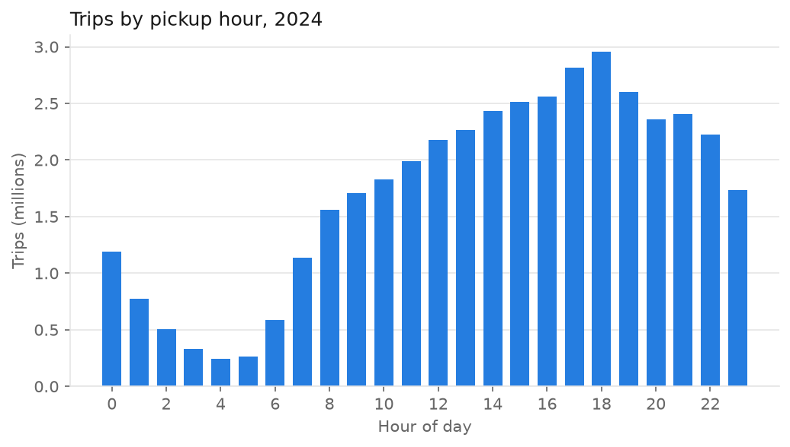
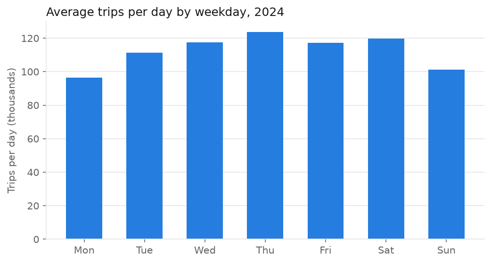
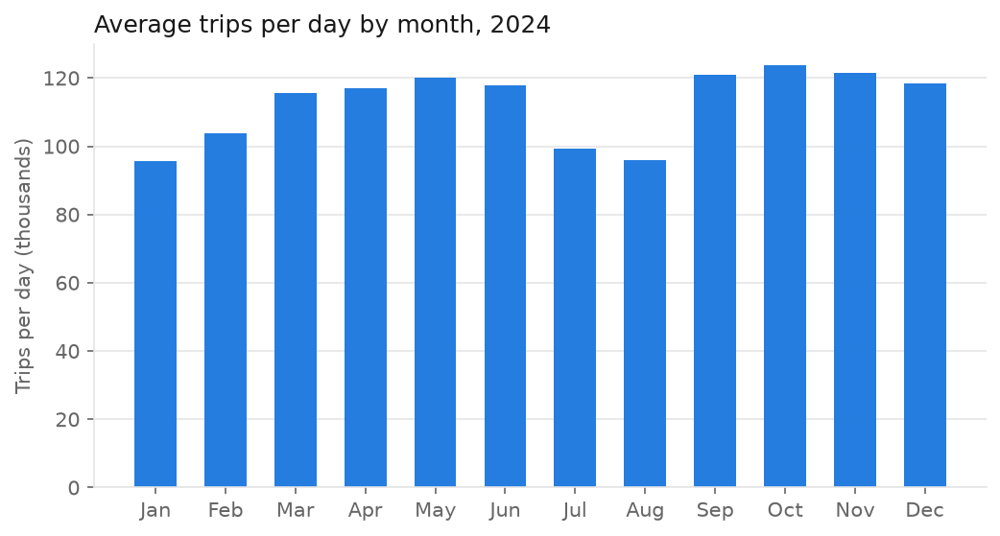
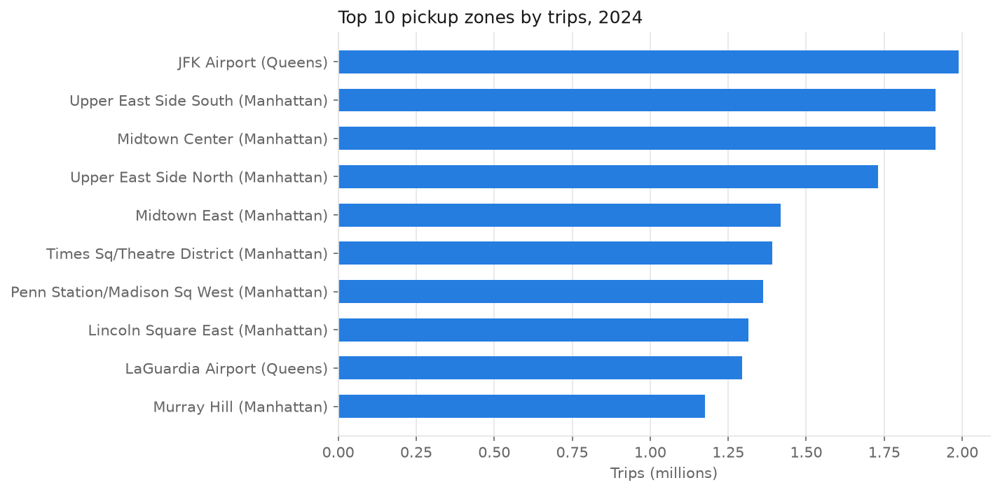
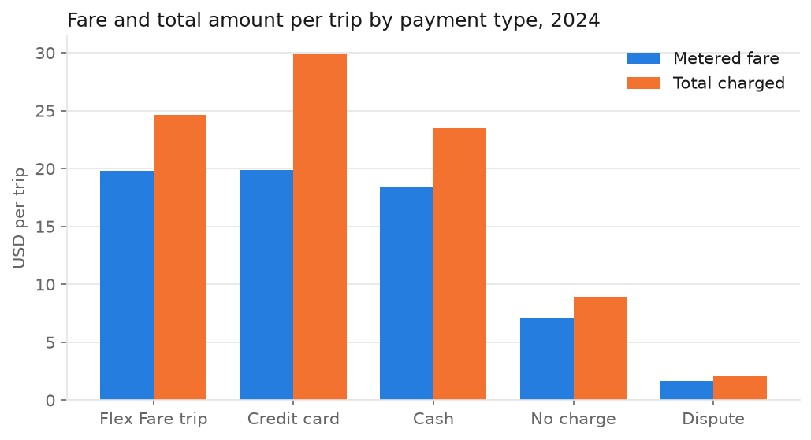
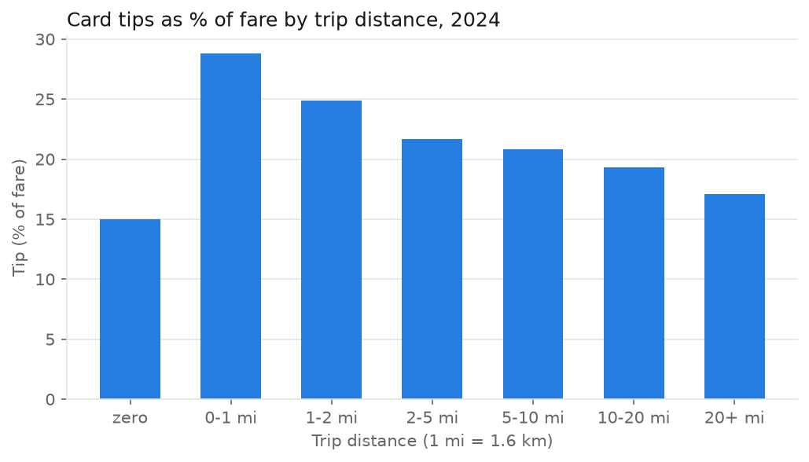
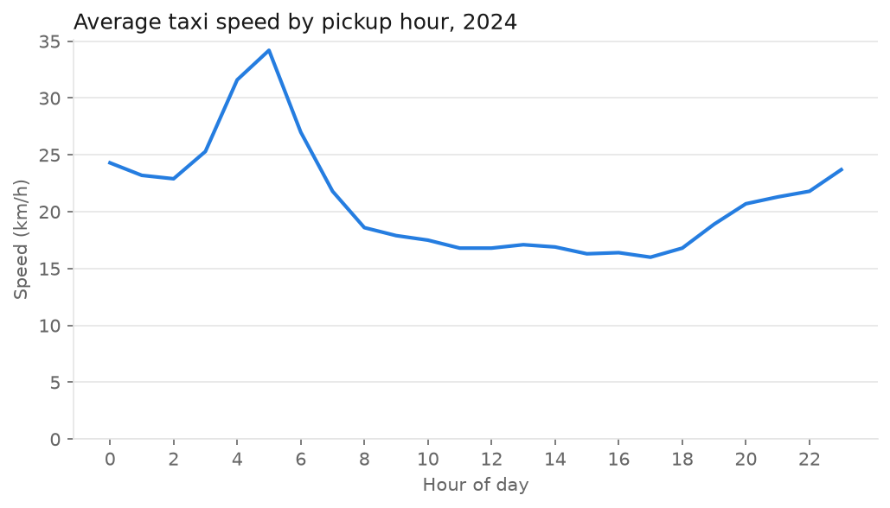
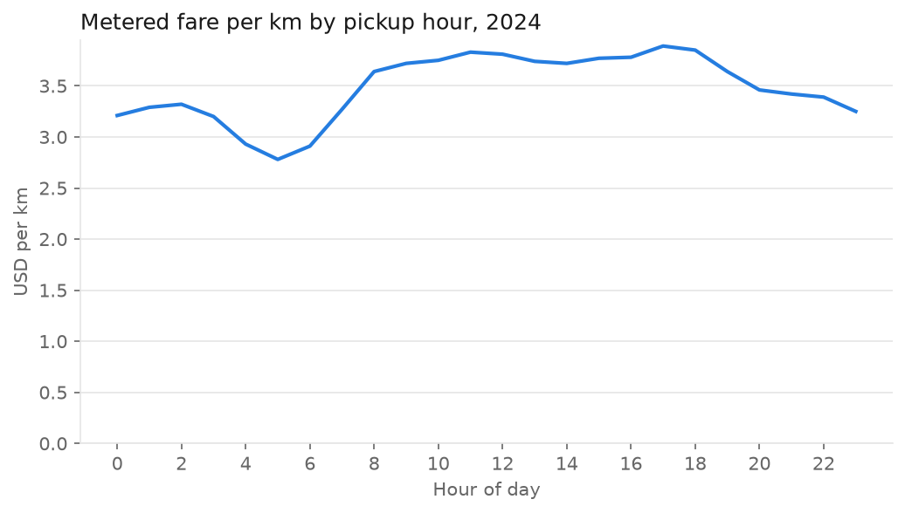

# Analysis

Answers to the business questions from the README, based on NYC yellow taxi trips from 2024 after the silver cleaning rules (41,155,786 trips). Charts are built by `analysis/charts.py` from the `rpt_` tables in the gold layer.

## 1. Demand

Demand is lowest at 4-5 am (about 0.25 million trips per hour over the year) and grows through the day to a peak at 6 pm (about 3 million).

Thursday is the busiest day (about 124 thousand trips per day), Monday and Sunday the quietest (about 96 and 101 thousand).

Demand dips in January and in July-August (about 96-99 thousand trips per day) and is highest in September-November (about 121-124 thousand). Hypothesis: the summer dip reflects holidays; it is not verified with other data.

## 2. Locations

JFK Airport is the busiest pickup zone (about 2 million trips). Eight of the top 10 zones are in Manhattan; the other two are the airports, JFK and LaGuardia.

## 3. Revenue and tips

Card trips bring the highest total amount per trip (29.91 USD) against 23.46 USD for cash, but their metered fares are close (about 20 and 18.5 USD). Most of the gap comes from tips, which are recorded only for card payments. Disputed trips average 2.04 USD because they include negative adjustments.

For card payments, the tip as a share of the fare falls with distance: from 28.8% for trips under 1 mile to 17.1% for trips over 20 miles. Trips with zero distance (15.0%) are mostly suspect records. 

*Hypothesis*: part of the tips are fixed amounts, which weigh more on short fares.

## 4. Efficiency

Trips with zero distance, negative amounts or distances above 100 miles are excluded here (3.5% of trips, see `data_quality.md`).

Taxis are slowest at 5 pm (about 16 km/h) and fastest at 5 am (about 34 km/h), when there are the fewest trips.

The metered fare per km follows traffic: about 3.9 USD between 8 am and 6 pm and about 2.8 USD at 5 am. The meter charges for time as well as distance, so slow traffic raises the price of each km.